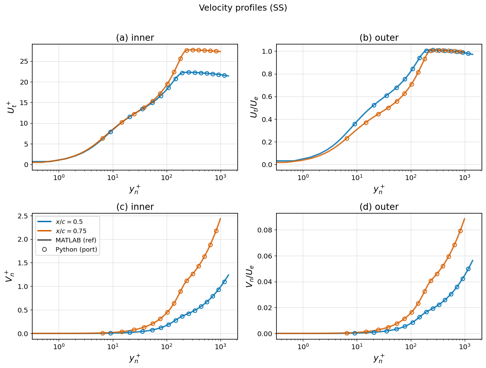
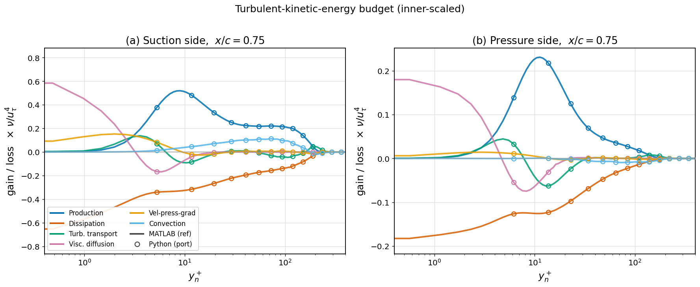
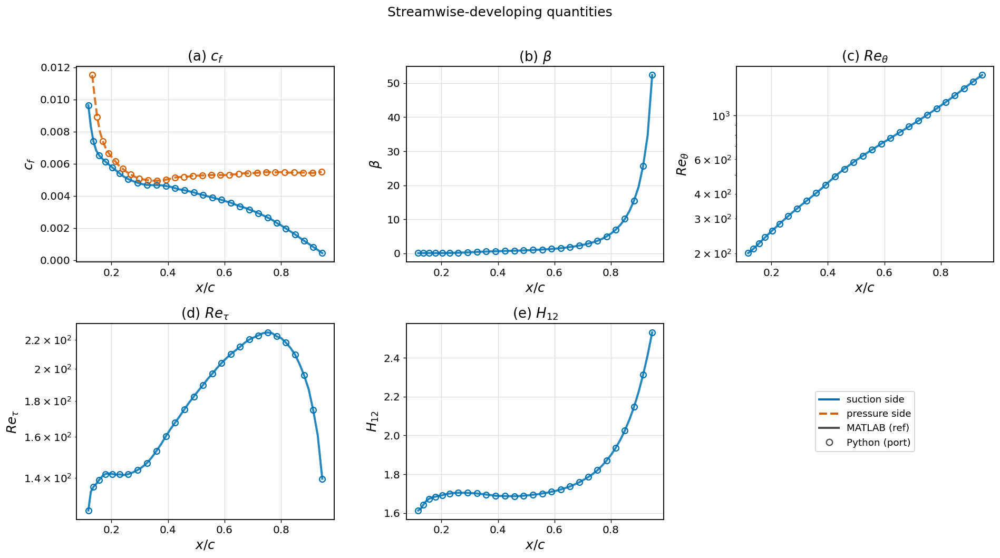
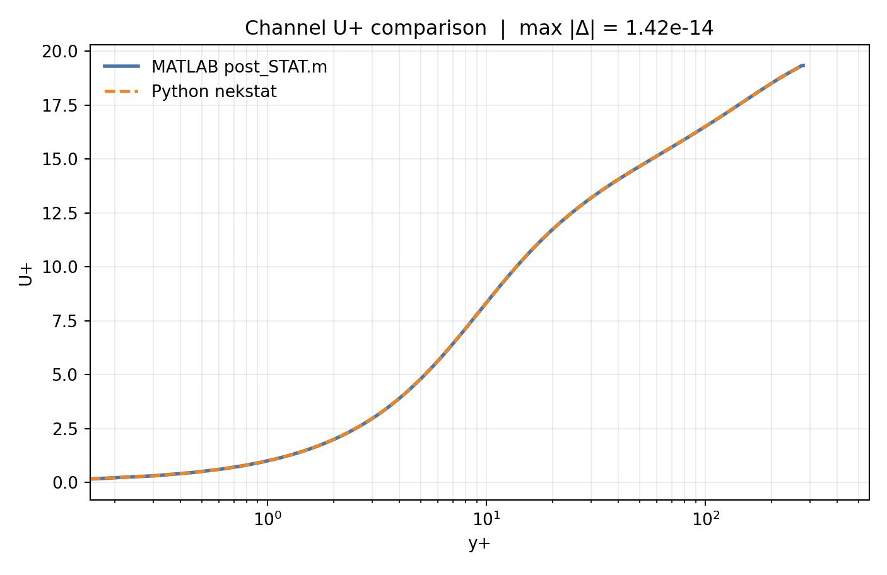
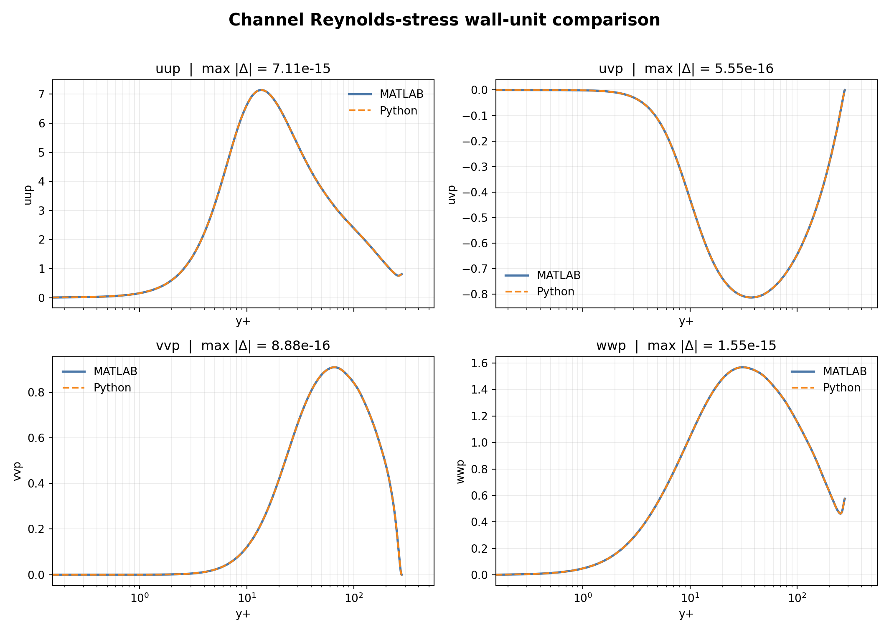

# nekstat

Post-processing of **Nek5000 on-the-fly wing statistics** for NACA airfoil
turbulent boundary-layer cases. The bundled production templates cover
NACA-4412 at Re<sub>c</sub> = 200 000, AoA = 5°, and NACA-0012 at
Re<sub>c</sub> = 200 000, AoA = 0°. A parallel KTH Framework/PSTAT2D workflow
covers the `no_resize_lc` channel-flow case at Reb = 4600. The airfoil pipeline reads the
interpolated statistics field `ZSTAT/int_fld`, rotates every quantity into the
wall-tangent / wall-normal frame, and produces boundary-layer profiles, integral
quantities, the full Reynolds-stress / turbulent-kinetic-energy budget, and the
C<sub>l</sub>/C<sub>d</sub> decomposition.

This is a pure NumPy/SciPy port of the original MATLAB pipeline and reproduces its
output to **float64 round-off** (see [Validation](#validation)).

---

## What it does

The simulation dumps span- and time-averaged statistics (`sts*`); a Nek5000
post-processing run spectrally interpolates them onto a wall-fitted mesh, giving
`ZSTAT/int_fld` (66 statistics + 68 derivatives per point). `nekstat` takes it
from there:

```
int_fld + int_mesh.mat                     (this package)
        │  read_data_profiles   rotate mean flow, Reynolds stresses, gradients,
        │                       and the full TKE budget into the wall frame
        │  load_prof_data       inner scaling, BL edge (diagnostic), Re_θ / Re_τ /
        │                       H₁₂ / β / Cf / Cp, budget scalars, Cl/Cd
        │  export               nested Re200k struct  ->  stat_*.mat
        ▼
   velocity profiles · TKE budgets · streamwise-developing quantities
```

## Install

### Python virtual environment

From a repository clone, run the following in its root directory (the directory
containing `pyproject.toml`):

```bash
git clone https://github.com/yuning-w/nekstat.git
cd nekstat
# If you already have a clone, start here from that directory.
python3 -m venv .venv
source .venv/bin/activate
python -m pip install --upgrade pip
python -m pip install -e .
python -m pip check
nekstat --help
```

The package declares Python ≥ 3.8. `pip install -e .` installs all Python runtime
dependencies from `pyproject.toml`: NumPy ≥ 1.20, SciPy ≥ 1.6, Matplotlib ≥ 3.3,
and PyYAML ≥ 5.1. No separate requirements file or `mpi4py` is needed. If
`python3 -m venv` reports that venv/ensurepip is unavailable, install your
distribution's venv support for that Python interpreter (for example,
`python3-venv` on Debian/Ubuntu), or use a site-provided Python with venv support.

For development/tests, install `python -m pip install -e '.[dev]'` to include
pytest. In each new shell, return to the clone and run
`source .venv/bin/activate`; use `deactivate` to leave the environment. On a
headless compute node, `export MPLBACKEND=Agg` selects file-only plotting.

For a package-only installation, use
`python -m pip install git+https://github.com/yuning-w/nekstat.git` inside the
activated environment instead. The sample dataset and case assets live in the
repository under `data/` (they are intentionally not bundled into the wheel
because `int_fld` is ~33 MB), so use a clone for the examples and build workflows.

Python-only processing of an existing `int_fld` needs no MPI, Fortran compiler,
or MATLAB. Building and running the Nek interpolation stage additionally needs
the case's solver source archive, Bash, Make, C/Fortran compilers, and an MPI
installation with compiler wrappers and a launcher; pip does not install these.

## Quick start

### Command line

```bash
# close the loop from ordered Nek sts files -> int_fld -> stat .mat
# edit source.path in the config first
nekstat run configs/naca4412_post.yml
nekstat run configs/naca0012_post.yml

# run blockwise windows and write Python-only Cl/Cd convergence CSVs
nekstat clcd-backward configs/naca4412_post.yml
nekstat clcd-backward configs/naca0012_post.yml

# independent control-volume momentum-balance check (same backward workflow)
nekstat backward-clcd configs/naca4412_control_volume_long_cycle.yml

# stage a run folder without launching Nek or Python post-processing
nekstat run configs/naca4412_post.yml --prepare-only

# stage the backward Cl/Cd run folder and write the planned window manifest
nekstat clcd-backward configs/naca4412_post.yml --prepare-only

# rebuild the case executable with the local MPI/compiler environment
nekstat build configs/naca4412_post.yml --rebuild
nekstat build configs/naca0012_post.yml --rebuild
nekstat build configs/channel_lc_post.yml --rebuild

# rebuild first, then stage/run/post from the same config
nekstat run configs/naca4412_post.yml --build --rebuild

# KTH PSTAT2D channel workflow
nekstat run configs/channel_lc_post.yml
nekstat channel-post configs/channel_lc_post.yml --int-fld tmp/no_resize_lc/int_fld --out tmp/result_data/channel_python.mat --no-figures
nekstat validate-channel --mine channel_python.mat --ref matlab_reference.mat

# process int_fld -> stat .mat   (defaults to the bundled sample case)
nekstat post --nek data --mesh data/int_mesh.mat --out stat.mat

# generate a complete mesh artifact set and check it against the 4412 reference
nekstat mesh configs/mesh_naca4412_reference.yml --ref data/int_mesh.mat

# plot the three figure categories for one dataset
nekstat plot --mat stat.mat --figdir figs

# overlay + machine-precision diff against a reference result
nekstat validate --mine stat.mat --ref data/reference/stat_benchmark_N11_naca4412_200k.mat
```

### Python API

```python
import nekstat
from nekstat import viz

# full pipeline -> Result (and optionally a .mat)
res = nekstat.run("data", "data/int_mesh.mat", out_file="stat.mat")

res.scal("ss", "Cf")          # suction-side skin friction vs streamwise station
res.prof("ss", res.station("ss", 0.75), "U")   # U profile at x/c = 0.75
res.scal("ss", "Cl")[0]       # 0.87120

viz.plot_single(res, "figs/")                       # solid-line figures
ref = nekstat.load_result("data/reference/stat_benchmark_N11_naca4412_200k.mat")
viz.plot_overlay(ref, res, "validation_figs/")      # overlay two datasets
```

## Output structure

`stat_*.mat` holds a `Re200k` struct with `top.ref` (suction side) and `bot.ref`
(pressure side), each a `1 × Nprof` struct array of profiles. Per profile:

| group | fields |
|---|---|
| geometry | `xa, ya, alpha, x, y, yn` |
| mean flow | `U, V, W, P, pp, dPdx, dPdy` |
| Reynolds stresses | `uu, vv, ww, uv, uw, vw` (+ inner-scaled `uup…uvp`) |
| scaling / edge | `ut, tauw, Ue, Uinf, delta99, deltas, theta, i99` |
| integral | `Cf, Cp, beta, Reth, Ret, H12` |
| TKE budget (inner) | `Pkp, Dkp, Tkp, VDkp, VPGkp, Ckp` |
| aerodynamics | `Cl, Cd, Cd_p, Cd_f, LD` |

The `Result` class wraps this: `.scal(side, field)`, `.prof(side, p, field)`,
`.station(side, x_c)`, `.yplus(side, p)`, with `side ∈ {"ss","ps"}`.

## Validation

Against the original MATLAB output (`stat_benchmark_N11_naca4412_200k.mat`,
same `int_fld`), every quantity agrees to float64 round-off:

| quantity | max &#124;Python − MATLAB&#124; | quantity | max diff |
|---|---|---|---|
| U, V | 2×10⁻¹⁶ | Cf | **0** (exact) |
| uu | 3×10⁻¹⁸ | β / Reθ | 4×10⁻¹⁴ / 1×10⁻¹² |
| TKE budget terms | ~1×10⁻¹⁶ | Reτ / H₁₂ | 3×10⁻¹⁴ / 1×10⁻¹⁵ |

The interpolation mesh generator reproduces the reference coordinates to below
`1×10⁻⁸`; its Fortran writer is checked by decoding `x.fort`/`y.fort` and
comparing every coordinate to the generated `.mat` metadata.

Overlay figures (MATLAB reference = lines, Python port = markers):





## Package layout

```
nekstat/
├── configs/             config-driven run templates
├── src/nekstat/
│   ├── read_intfld.py   read_data_profiles.m  (binary read + all rotations + budgets)
│   ├── postproc.py      load_prof_data.m       (integral quantities, Cf/Cp, Cl/Cd)
│   ├── diagnostic.py    diagnostic.m + trapezoidal2.m + MATLAB-style interp1
│   ├── export.py        export_drag_decomposition.m + Re200k .mat writer
│   ├── naca_geom.py     naca_prof2 / create_profiles / rot / save_inter_mesh
│   ├── pipeline.py      high-level run() / process()
│   ├── nek5000.py       config -> runs/<name> staging + Nek launch + post hook
│   ├── clcd_backward.py blockwise backward Cl/Cd convergence sweeps
│   ├── kth_channel.py   KTH Framework/PSTAT2D channel staging + run hook
│   ├── channel_intfld.py/channel_pipeline.py
│   │                    KTH int_fld reader + MATLAB-free channel post
│   ├── result.py        Result accessor
│   ├── cli.py           `nekstat` command
│   └── viz/             velocity / budget / streamwise plots (single + overlay)
├── data/                sample case: ZSTAT/int_fld, x.fort, y.fort, int_mesh.mat,
│                        reference/stat_benchmark_N11_naca4412_200k.mat,
│                        dependencies/<case> reusable Nek case assets,
│                        meshes/naca0012 copy-mode interpolation mesh
├── runs/                generated run workspaces (ignored by git)
├── examples/run_pipeline.py
└── docs/                figures for this README
```

## Config-Driven Nek Stage

`nekstat run <config.yml>` creates a reproducible run folder, saves the resolved
configuration as `current_conf.yml`, stages the selected case dependencies,
orders the selected source `sts*` window into `ZSTAT/stsnaca_wing0.fNNNNN`,
patches the Nek `.rea` statistics parameters, launches the case-local executable,
and then calls the existing Python post-processing pipeline.

The original Nek solver archive is preserved in `tmp/Nek1093_dong.tar.gz` for
portable rebuilds; the config-driven run path uses the precompiled executable in
`data/dependencies/naca4412/nek5000_4412`.

### Build with your local MPI environment

`~/.bashrc.openmpi_ucx` is a machine-specific environment setup script, not a
nekstat requirement. To use your current environment, first load your site's
matching compiler/MPI modules or set `PATH` and library paths for your local MPI
installation. Then edit the existing sections of your chosen config:

```yaml
build:
  env_script: null
  # Keep the other build fields from the case template.
nek:
  env_script: null
  mpirun: mpirun
  # Keep the other runtime fields from the case template.
```

Omitting `env_script` has the same effect as YAML `null`: the subprocess inherits
the environment of the shell running `nekstat`. Set this for both build and run
if either specifies a script; the channel template specifies it in both places.
Alternatively, point both fields at your own environment script (prefer an
absolute path). The build script's environment is local to that subprocess and
does not carry over automatically to a later Nek run.

Check that the required wrappers and launcher are available, then rebuild:

```bash
command -v mpif90 mpicc mpirun     # airfoil cases
# command -v mpifort mpicc mpirun  # KTH channel case
nekstat build configs/naca4412_post.yml --rebuild
# Other case templates:
# nekstat build configs/naca0012_post.yml --rebuild
# nekstat build configs/channel_lc_post.yml --rebuild
```

This extracts `tmp/Nek1093_dong.tar.gz` into `tmp/Nek1093_dong` when needed,
stages the compile work directory from `data/dependencies/naca4412`, runs the
case compile command in `build.work_dir`, and installs the resulting executable
at `build.output`. An environment script is sourced only if configured. Make
sure the archive named by `build.archive` is available, or provide the extracted
source tree at `build.source_dir`; these solver sources are not installed by pip.

Use the same compiler/MPI installation to build and run. `--rebuild` is needed
when changing stacks because existing executables are otherwise skipped by
default. `nek.mpirun` can also be an absolute launcher path; it is invoked as
`mpirun -n <np> <executable>`. After setting your input paths and averaging window,
`nekstat run configs/naca4412_post.yml --build --rebuild` builds and runs in one
command.

The bundled airfoil compile scripts set `F77="mpif90 -std=legacy"` and
`CC="mpicc"`; these names resolve through your local `PATH`. They assume GNU
Fortran-compatible flags. For different wrapper names or compiler families,
edit `data/dependencies/naca4412/compile-script` or
`data/dependencies/naca0012/makenek` and adjust compiler flags for that compiler.
The channel entry point, `data/dependencies/no_resize_lc/01-compile-command`,
sets `FC` to `mpifort` plus the KTH include flags and defaults `CC` to `mpicc`.
Setting `build.env.F77`/`FC` alone cannot override assignments hardcoded in these
scripts. Edit the dependency templates, since build staging can overwrite edits
made directly in `tmp/*_compile`. Other compiler families have not been validated
by this setup recipe.

When `nek.sampling_start_time` is omitted or set to `auto`, `nekstat` reads the
132-byte header of the preceding `sts` file and uses that end time for Nek
parameter `p070`. If `source.first_file` is `1`, there is no predecessor, so set
`nek.initial_start_time` explicitly, or set
`nek.allow_first_file_end_time_as_start: true` if that legacy zero-interval first
file behavior is intended. The run launcher also creates the Nek output
directory `A0`, clears stale `A0` field files, removes old `ZSTAT/int_fld` and
`*.sch*` files, and checks the Nek log for the configured completion marker.

The ready templates are:

| config | case | Nek source | mesh |
|---|---|---|---|
| `configs/naca4412_post.yml` | NACA4412, Re=200k, AoA=5 deg | `tmp/Nek1093_dong.tar.gz` | `data/ZSTAT`, `data/int_mesh.mat` |
| `configs/naca0012_post.yml` | NACA0012, Re=200k, AoA=0 deg | `tmp/nek1072.tar.gz` | `data/meshes/naca0012/` |
| `configs/channel_lc_post.yml` | channel `no_resize_lc`, Reb=4600 | `tmp/KTH_Framework.tar.gz` | `DATA/int_pos`, `DATA/c2Dtcf0.f00001` |

The main config fields are:

| section | purpose |
|---|---|
| `run` | run name and root folder, e.g. `runs/naca_wing_XXX` |
| `case` | case id, Nek session name, dependency folder, executable |
| `build` | solver archive, local MPI environment script, compile command, output executable |
| `mesh` | copy or generate `ZSTAT/x.fort`, `ZSTAT/y.fort`, and matching mesh metadata |
| `source` | source result tree, glob, and 1-based window over sorted `sts*` files |
| `nek` | MPI launch settings and `.rea` parameter overrides |
| `post` | existing Python `int_fld -> stat_*.mat` options |
| `clcd_backward` | Python-only blockwise Cl/Cd convergence sweep options |
| `pstat2d` / `channel_post` | KTH PSTAT2D `tcf.par` patching and channel `.mat` export |

Use `--prepare-only` to stage and inspect the folder on a login node. Use
`--skip-nek` or `--skip-post` when one stage has already been completed.

For the NACA0012 template, the archived run used `source.first_file: 1` and
`nek.initial_start_time: 7.000000000028`. If you start from a later sorted
`sts` file, keep `nek.sampling_start_time: auto` and the launcher will read the
predecessor header. If your first selected file is still file 1 but begins at a
different physical time, update `nek.initial_start_time` in the config.

### Backward Cl/Cd convergence

`nekstat clcd-backward <config.yml>` uses the shared `case`, `build`, `mesh`,
`source`, and `nek` sections, then reads `clcd_backward` for the sweep-specific
window and output settings. The ordinary `nekstat run` command continues to use
the `post` section for the full `int_fld -> stat_*.mat` export.

The backward workflow first splits selected `sts` files into chronological
short blocks. The NACA templates use `block_mode: accumulator_reset`, which
reads the `sts` header sample count and starts a new block whenever that count
drops. This marks a fresh statistics accumulator cycle, for example
`7500, 10000, ..., 30000, 5000` becomes two blocks, with the second block
starting at the `5000` file.

For every block, `p070` is inferred from the predecessor `sts` header, so the
Nek averaging interval is exactly the block start time to the block end time.
The block table records the first and last `sts` sample counts so reset-detected
blocks can be audited.

`clcd_backward.allow_time_overlap_between_blocks: true` allows physical-time
overlap between two detected accumulator cycles. Time must still increase
strictly inside each block; when a reset block overlaps the previous block, its
start time is inferred from its own `sts` sample-count/time slope rather than
from the previous cycle's last file.

Use `block_mode: fixed_files` with `block_size_files: 10` to force constant-size
blocks such as `100-109`, `110-119`, `120-129`. In that fixed mode, if the
selected file count is not divisible by `block_size_files`, the final short
block is dropped by default. Set `include_incomplete_block: true` to keep that
shorter-duration fixed block.

The backward convergence table is computed from the block table using
duration-weighted averages over the latest block, latest two blocks, latest
three blocks, and so on.

The Cl/Cd CSV filenames are derived from the top-level `run.name`.

The run folder contains:

```text
runs/naca_wing_clcd_backward/
├── <run.name>_clcd_blocks.csv
│                          # updated atomically after each finished Nek block
├── <run.name>_clcd_backward.csv
│                          # duration-weighted backward averages over blocks
├── nek_windows.csv         # planned/generated/reused Nek block windows
├── int_fld/                # per-block int_fld snapshots
├── logs/                   # per-block Nek logs
├── ZSTAT/                  # staged sts files and transient int_fld
└── A0/                     # transient Nek output directory
```

Existing valid per-block `int_fld` files are reused unless `--force` or
`clcd_backward.force: true` is set. `--skip-nek` recomputes the CSVs from existing
`int_fld` snapshots. `--discard-int-fld` removes those snapshots after the CSV is
written. The block CSV is created with its header before Nek starts, then atomically
rewritten with one additional row immediately after every generated or reused block;
it therefore remains safe to inspect while a later block is running. The coefficient
extraction is pure Python. The default surface method reads only `F4` and
`D1-D4`; the optional control-volume method reads `F1`, `F2`, `F4`, `F5`,
`F6`, and `F9` instead.

#### Optional control-volume check

The default `clcd_backward.method` is `surface`, which is the standard,
wall-profile pressure-and-viscous-force calculation. Set
`method: control_volume` only when an independent 2-D momentum-balance check
is wanted. It is intentionally a mode of the existing backward workflow, not
a separate general post-processing pipeline.

The canonical example is
`configs/naca4412_control_volume_long_cycle.yml`. Its mesh reproduces the
paper's rectangle, and its `source` range keeps every available block before
the desired backward row is selected. Do not pre-truncate `source` merely to
obtain a late backward average.

```yaml
mesh:
  mode: generate
  kind: control_volume
  cartesian:
    x: {start: -0.25, stop: 1.25, spacing: 0.0025}
    y: {start: -0.25, stop: 0.25, spacing: 0.0025}
  output:
    mat_file: int_mesh.mat
    write_figure: false

clcd_backward:
  method: control_volume
  mesh: auto
  block_mode: accumulator_reset
  # Keep source.first_file/source.last_file as the full study range.
```

To modify the volume, change only the two Cartesian axes: `start`/`stop`
change the four faces and `spacing` changes sampling resolution. Then rerun
the full backward study and compare the same backward row. The control-volume
CSV reports `Cl_convective`, `Cl_reynolds`, `Cl_pressure` and the analogous
drag terms; `Cd_p` and `Cd_f` are intentionally `nan`, because they are
surface-force decompositions, not control-volume terms.

This method assumes a steady, two-dimensional balance and omits the viscous
outer-boundary flux, as in the cited paper. Treat it as an uncertainty check
against surface integration—not as a parameter to tune until rounded target
coefficients are reproduced. The full rationale and convergence evidence are
in `docs/mesh_long_horizon_search_log.md`.

### KTH channel workflow

`workflow: channel2d` selects the KTH Framework/PSTAT2D path. It stages the
`tcf` case assets, `DATA/int_pos`, `DATA/c2Dtcf0.f00001`, and selected source
`ststcf0.f*` files. Because this KTH case ignores `STS_FFILE`, selected source
files are renumbered into `DATA/ststcf0.f00001...`, and `_PSTAT2D:STS_NFILE`
plus `_PSTAT2D:STS_STIME` are patched in `tcf.par`.

The MATLAB `post_STAT.m` step is replaced by `nekstat channel-post`, which reads
the KTH `int_fld` format directly, computes the same channel profile fields and
wall units, writes a MATLAB `data` struct, and can regenerate the same figure
set. `validate-channel` reports max absolute differences against a MATLAB
reference `.mat` when MATLAB is available on HPC.

Fresh channel parity check against MATLAB `post_STAT.m` output, focused on the
wall-unit velocity and Reynolds-stress profiles used for the channel case:

| field | max &#124;Python − MATLAB&#124; |
|---|---:|
| `Up` | 1.421e-14 |
| `uup` | 7.105e-15 |
| `uvp` | 5.551e-16 |
| `vvp` | 8.882e-16 |
| `wwp` | 1.554e-15 |





## Mesh generation

`nekstat mesh <config.yml>` generates a self-consistent artifact set: the
little-endian Fortran-record `ZSTAT/x.fort` / `y.fort` Nek inputs, the matching
`int_mesh.mat` Python metadata, a mesh image, and a checksum manifest. The
standalone example is `configs/mesh_naca4412_reference.yml`.
`configs/mesh_naca0012_reference.yml` and `configs/mesh_farfield.yml` show the
symmetric-profile and coordinate-only Cartesian forms respectively.

The generator provides these compatibility presets:

- `naca4412_reference`: the committed NACA4412 mesh (83 stations × 190
  wall-normal points, 31,540 points total), clustered to `x/c=0.295` with
  `dx=0.01625` thereafter.
- `naca4412_script_current`: the currently uncommented legacy MATLAB settings
  (`x/c=0.395`, `dx=0.015`), which intentionally produce a different mesh.
- `naca0012_reference`: the supplied NACA0012 mesh (80 × 857, 137,120 points).

The generated reference coordinates agree with the bundled MATLAB assets to
better than `1e-8`; their `.fort` files are decoded and checked against their
generated `.mat` coordinates in the test suite. NACA00xx now uses an explicit
symmetric-airfoil geometry branch.

For a full Nek run, set `mesh.mode: generate`, choose a preset or parameters,
and use `post.mesh: auto`. The run preparer then writes the `.fort` files and
the exact matching `.mat` file into its run directory. Coordinate-only
`kind: cartesian` meshes are available for far-field and control-volume
sampling. They are rejected by profile post-processing and the default surface
Cl/Cd integration, but are accepted when
`clcd_backward.method: control_volume` is selected. Do not set `post.mesh:
auto` for a Cartesian control-volume run: it has no wall-profile metadata and
needs no Python `stat_*.mat` export.
Use `extrusion: vertical` with `kind: wall_normal_profile` to reproduce the
legacy no-rotation profile sampling convention.

`configs/naca4412_mesh_recommended.yml` records a six-file force-comparison
mesh selected by the documented sensitivity study in
`docs/mesh_optimization_test_log.md`. It is a short-window benchmark candidate,
not a replacement for convergence over a production-length averaging interval.

```yaml
mesh:
  mode: generate
  preset: naca4412_reference
  output:
    write_figure: false
post:
  mesh: auto
```

## Relation to the original MATLAB code

Direct ports of `main_post_proc_prof.m` and its dependencies. Behavioural details
are preserved deliberately, including the wall-frame rotations, the boundary-layer
edge criterion (`|u'|/U / √H₁₂ < 0.02`), the `bottom(1)=top(1)` leading-edge alias,
and the default export window (profiles 26–80). The Fortran 77 decode/interpolation
stage (Nek5000) is unchanged; `nekstat run` now stages and launches it before
handing `ZSTAT/int_fld` to the Python pipeline.

## License

MIT © 2026 Yuning Wang
